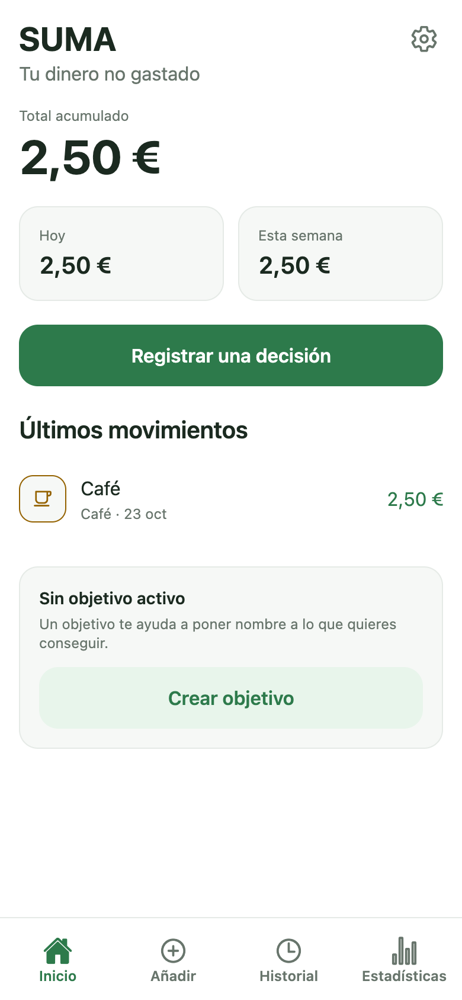

# SUMA

Aplicación móvil de ahorro consciente: registra el dinero que decides **no gastar** y muestra el progreso acumulado.

> El importe registrado es una estimación declarada por el usuario del gasto que ha evitado. No implica que el dinero esté apartado, que exista una cuenta de ahorro ni que el patrimonio haya aumentado.

## Estado

Implementación del MVP en curso por fases:

- **Fases 0–5 completadas** según el plan: memoria, esqueleto, dominio/persistencia, registro e Inicio, historial/estadísticas/objetivos y calidad.
- **104 pruebas automatizadas en verde** (unitarias, integración con SQLite real y componentes).
- La aplicación empaqueta para iOS y Android, pero **no se ha ejecutado en simulador ni dispositivo** en este entorno.
- Bloqueos externos: licencia de Xcode no aceptada, sin JDK/Android SDK y sin cuentas de tienda.

El estado detallado, con evidencias y limitaciones, está en [docs/STATUS.md](docs/STATUS.md).

## Funcionalidades

- Onboarding con moneda y primer día de semana.
- Registro de decisiones con importe, categoría, nota y fecha.
- Importes rápidos configurables y persistentes: el lápiz permite editar cada importe y se guarda en el dispositivo.
- Inicio con total acumulado, hoy, semana, últimos movimientos y objetivo.
- Historial paginado con filtros por categoría y periodo, orden y edición.
- Edición y eliminación de registros con confirmación.
- Estadísticas por día, semana, mes y año con comparación, promedios, mejor día y distribución por categorías.
- Gráficas propias (barras, línea y barras de categorías) accesibles.
- Un objetivo activo con progreso calculado desde los registros.
- Ajustes: moneda, primer día de semana, exportación JSON y restablecimiento de datos.
- Persistencia local SQLite con migraciones, transacciones y reapertura segura.

Fuera del MVP: cuentas, sincronización, notificaciones, analítica, IA, varios objetivos, categorías personalizadas, modo oscuro, pagos y publicación.

## Stack

| Capa         | Tecnología                                    |
| ------------ | --------------------------------------------- |
| Runtime      | Expo SDK 58, React Native 0.88, React 19.3    |
| Lenguaje     | TypeScript 6 estricto                         |
| Navegación   | Expo Router 58                                |
| Persistencia | SQLite con `expo-sqlite`                      |
| Formularios  | React Hook Form                               |
| Validación   | Zod 4                                         |
| Gráficas     | `react-native-svg`                            |
| Pruebas      | Jest, jest-expo, Testing Library, `sql.js`    |
| Calidad      | ESLint, Prettier, Expo Doctor, GitHub Actions |

## Requisitos

- Node.js 24 o superior.
- pnpm 10.
- Para ejecutar en dispositivo: Expo Go o un build de desarrollo.
- Para compilar nativo: Xcode (iOS) o JDK + Android SDK (Android), o EAS Build.

## Instalación

```bash
pnpm install
```

## Ejecución

```bash
pnpm start        # servidor de desarrollo
pnpm ios          # intenta abrir el simulador de iOS
pnpm android      # intenta abrir el emulador de Android
```

En el entorno actual `ios` y `android` no pueden completarse: falta aceptar la licencia de Xcode y no hay JDK/Android SDK. Los bundles sí se generan:

```bash
pnpm exec expo export --platform ios --platform android
```

## Versión web / PWA

La misma aplicación se puede servir como PWA y añadir a la pantalla de inicio del móvil. Usa `react-native-web`, SQLite en el navegador (WASM) y un service worker para funcionar sin conexión.

```bash
pnpm web:build          # genera dist/ (HTML, JS, manifest, service worker, iconos)
pnpm web:serve          # http://localhost:8085 (para probar en este Mac)
pnpm web:smoke          # prueba automatizada con Chrome (servidor ya arrancado)
```

Para abrirla en el móvil hace falta **HTTPS**, porque SQLite web necesita `SharedArrayBuffer` y un origen aislado:

```bash
brew install mkcert && mkcert -install
pnpm web:cert           # certificado local para localhost y la IP del Mac
pnpm web:serve:https    # https://<ip-del-mac>:8085
```

Después, en el móvil: abrir la URL, confiar en el certificado local (instrucciones en la guía), y usar "Añadir a pantalla de inicio" (iOS) o "Instalar app" (Android).



Limitaciones: los datos de la PWA viven en el navegador de ese origen y son independientes de la app nativa; si cambia la URL (IP o túnel) cambia el almacenamiento. La guía completa está en [docs/LOCAL_TESTING.md](docs/LOCAL_TESTING.md).

## Scripts

| Comando                             | Descripción                     |
| ----------------------------------- | ------------------------------- |
| `pnpm start`                        | Servidor de desarrollo          |
| `pnpm typecheck`                    | TypeScript estricto, sin emitir |
| `pnpm lint`                         | ESLint                          |
| `pnpm format` / `pnpm format:check` | Prettier                        |
| `pnpm test`                         | Jest (20 suites)                |
| `pnpm test:integration`             | Pruebas de persistencia         |
| `pnpm export:check`                 | Exporta bundles iOS/Android     |

> Con pnpm, usa `pnpm exec jest --runInBand` para pasar argumentos a Jest (el separador `--` no se reenvía).

## Estructura

```
app/                    rutas Expo Router
src/domain/             entidades, dinero, fechas, cálculos, validación (puro)
src/data/               driver SQL, migraciones, repositorios, exportación
src/features/           casos de uso y pantallas por dominio
src/components/         UI, feedback, entries, goals, charts
src/theme/              tokens de diseño
src/i18n/               textos en español
tests/                  unitarias, integración y componentes
docs/                   memoria del proyecto y ADR
```

La separación interfaz / dominio / datos y los contratos están en [docs/ARCHITECTURE.md](docs/ARCHITECTURE.md).

## Datos y privacidad

- Todo se guarda localmente en SQLite; la app no envía datos a ningún servidor.
- No hay analítica ni informes remotos de fallos.
- La exportación JSON incluye las notas personales y se comparte solo mediante la hoja del sistema.
- El borrado de un registro es inmediato e irreversible; el restablecimiento de datos exige confirmación.
- La moneda no se puede cambiar mientras existan registros, para no sumar importes de monedas distintas.

Más detalle en [docs/SECURITY.md](docs/SECURITY.md).

## Pruebas

```bash
pnpm exec jest --runInBand
```

Cubren dinero y redondeos, fechas y cambios de hora, periodos y comparaciones, migraciones, CRUD, restricciones, persistencia tras reapertura, transacciones, preparación de formularios, objetivos, componentes y accesibilidad básica. Ver [docs/TEST_STRATEGY.md](docs/TEST_STRATEGY.md).

No se han ejecutado pruebas E2E ni de lector de pantalla: requieren simulador o dispositivo.

## Limitaciones conocidas

- Verificación nativa pendiente (licencia de Xcode, ausencia de Android SDK).
- La fecha se introduce como texto `AAAA-MM-DD` con atajos Hoy/Ayer; no hay selector nativo.
- Un único objetivo activo; sin asignación de registros por objetivo.
- Exportación solo JSON; no hay importación todavía.
- Modo oscuro, notificaciones, cuentas y sincronización fuera del MVP.
- El rendimiento medido corresponde a Node/sql.js; debe validarse en dispositivo.

## Documentación

- [Cómo probar en local](docs/LOCAL_TESTING.md)
- [Arquitectura](docs/ARCHITECTURE.md)
- [Plan de ejecución](docs/EXECUTION_PLAN.md)
- [Estado](docs/STATUS.md)
- [Modelo de datos](docs/DATA_MODEL.md)
- [Contratos](docs/API_CONTRACTS.md)
- [Diseño](docs/DESIGN_SYSTEM.md)
- [Seguridad](docs/SECURITY.md)
- [Pruebas](docs/TEST_STRATEGY.md)
- [Despliegue](docs/DEPLOYMENT.md)
- [Decisiones](docs/DECISIONS.md)

## Licencia

Pendiente de definir por el titular del producto.
