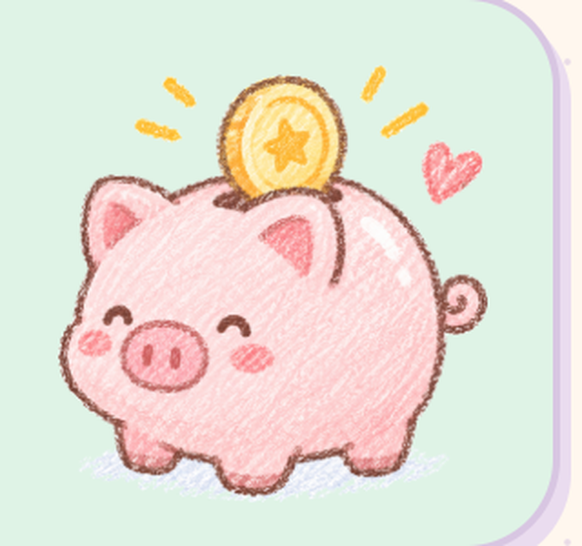
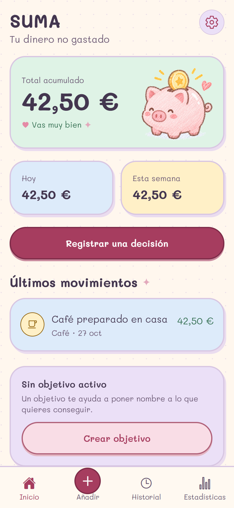
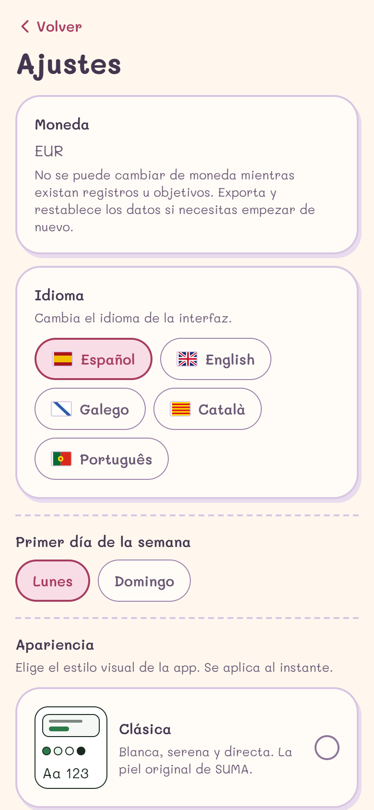
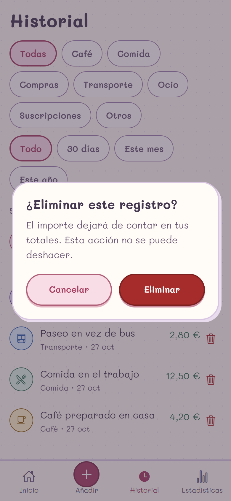
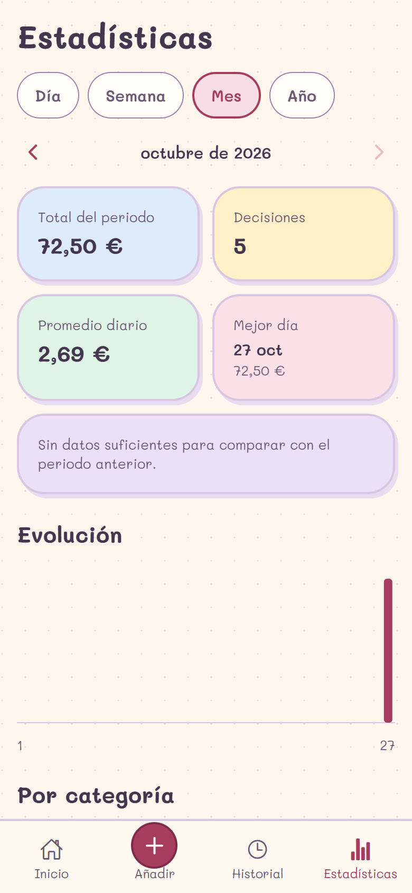
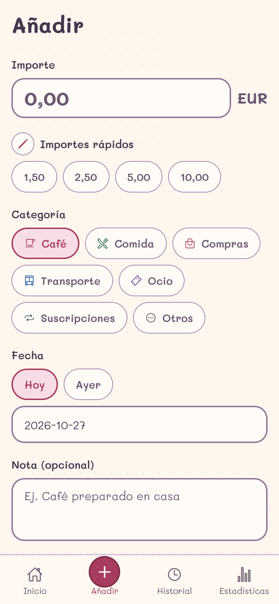

# SUMA — Skins visuales

| Campo | Valor |
|---|---|
| Versión | 1.0 |
| Fecha | 2026-10-27 |
| Estado | Implementado (primera skin adicional: Kawaii cozy) |
| Referencia | `docs/DESIGN_SYSTEM.md`, imagen de referencia "Panel financiero pastel con doodles kawaii" |

## 1. Qué es una skin

Una **skin** es una identidad visual completa y seleccionable desde Ajustes: paleta, tipografía, formas, superficies, decoración e ilustración. No es un modo oscuro ni un cambio de marca: la estructura, los textos y la lógica de SUMA no cambian.

- La skin **Clásica** es la original y sigue siendo la opción por defecto. Se conserva sin cambios para no romper la familiaridad de quien ya usa la app.
- La skin **Kawaii cozy** es la primera skin adicional. La idea es que Ajustes pueda ofrecer más en el futuro sin tocar las pantallas.

La elección se guarda en el perfil local (`user_profile.skin`) y viaja en las copias de seguridad JSON. Las copias antiguas sin el campo se importan como Clásica.

## 2. Dirección artística: "cuaderno de ahorro"

Kawaii no significa infantil ni ruidoso. La skin se apoya en el imaginario de un **cuaderno de ahorro hecho a mano**: papel crema con grano, tarjetas que parecen pegatinas, trazo lavanda, tipografía manuscrita y un cerdito ahorrador como mascota.

Decisiones:

- **El total acumulado sigue siendo el protagonista**, ahora dentro de una tarjeta verde menta con el cerdito a un lado. Es el único momento "grande" de la pantalla; el resto se mantiene disciplinado.
- **Color con función**: los pasteles son superficies; el texto va siempre en ciruela oscuro y las acciones en rosa profundo. Ningún pastel se usa como color de texto.
- **Pegatinas, no tarjetas SaaS**: borde de 2 px, esquinas muy redondeadas y sombra dura desplazada 3–4 px. Sin degradados ni sombras difusas.
- **Doodles con moderación**: cerdito en Inicio y Onboarding, destellos y corazones en pequeñas dosis. Nunca compiten con contenido ni se anuncian a lectores de pantalla.
- **Una sola tipografía con tres pesos** (Mali) para que la interfaz se lea como escrita a mano; los números no usan `tabular-nums` real, así que los importes se alinean por contenedor, no por glifo.
- **La barra inferior** mantiene cuatro destinos; "Añadir" se convierte en un botón circular rosa, guiño al FAB de la referencia.

## 3. Paleta

Todos los pares texto/fondo usan AA (≥ 4,5:1) y los bordes de controles ≥ 3:1. La comprobación es automática en `tests/unit/tokens.test.ts`.

| Token | Hex | Uso | Contraste |
|---|---|---|---|
| background | `#FFF7EE` | Papel crema | — |
| surface | `#FFFCF7` | Tarjeta base | — |
| text | `#43364F` | Texto principal | 10,53:1 sobre papel |
| textMuted | `#6A5873` | Texto secundario | 6,08:1 sobre papel |
| primary | `#A63D5F` | Acciones y enlaces | 5,73:1 sobre papel; blanco sobre primary 6,08:1 |
| primarySoft | `#F9DDE6` | Fondo seleccionado | primary sobre primarySoft 4,78:1 |
| danger | `#A62B2B` | Errores y borrado | 6,59:1 sobre papel |
| positive | `#2F6B4D` | Importes registrados | 5,94:1 sobre papel |
| border | `#D8C6E2` | Trazo decorativo | — |
| borderStrong | `#8E7699` | Bordes de inputs | 3,8:1 sobre papel |
| stickerShadow | `#EADCEF` | Sombra dura de pegatina | — |

Superficies pastel (tonos de `Card`):

| Tono | Hex | Uso típico |
|---|---|---|
| mint | `#DFF3E6` | Total acumulado / objetivo cumplido |
| blue | `#DDEBFA` | Resumen del día / últimos movimientos |
| butter | `#FFF0C7` | Resumen de la semana |
| pink | `#FBE0E8` | Objetivo en curso |
| lilac | `#EBE0F7` | Sin objetivo / ajustes de bienvenida |

Categorías: ámbar `#8A5A00`, verde `#2F6B4D`, rosa `#A63D5F`, azul `#2C5DA8`, violeta `#6B489E`, pizarra `#4C5A6B`, piedra `#5B544E`. Se usan como acento y siempre acompañadas de texto o icono.

Ilustración: la mascota es la ilustración crayon del producto, guardada como PNG con fondo transparente en `assets/skin/piggy-bank.png` (recortada, 480 px de ancho). Los destellos y corazones que la acompañan usan `illustration.sparkle` `#E3A9BC` e `illustration.heart` `#E58AA6`.



## 4. Tipografía

- **Mali** (OFL, incluida en `assets/fonts/`) en tres pesos: 400 Regular, 600 SemiBold y 700 Bold.
- Escala: display 42/48, título 30/36, sección 21/28, cuerpo 16/25, etiqueta 15/21, auxiliar 13/18.
- Sin `fontWeight` sintético: cada peso es un archivo y una familia registrada en `expo-font`.
- Los textos auxiliares no bajan de 13 px para mantener la legibilidad de una fuente manuscrita.
- La skin Clásica sigue usando la fuente del sistema con su escala original.

## 5. Forma y composición

- Radios: 16 (campos), 20 (controles), 26 (tarjetas), 28 (hoja), 999 (pastillas y botones).
- Tarjetas con `borderWidth: 2` y sombra dura (`shadowOffset 3/4`, `shadowRadius 0`).
- Botones tipo pastilla (54 px de alto) con borde más oscuro y sombra; al pulsar se hunden 1 px.
- Chips con borde de 1,5 px; el estado seleccionado se marca con borde rosa de 2 px, fondo `primarySoft` y texto `primary`, además de `accessibilityState.selected`.
- Espaciado: la escala de 4/8/12/16/20/24/32 se mantiene; las tarjetas usan 18 px de padding.
- Fondo de papel: patrón de puntos cada 22 px al 55 % de opacidad. Los doodles viven dentro de tarjetas y secciones, no fijos tras el contenido, para no chocar con textos ni controles al hacer scroll. Se monta una sola vez por pantalla, fuera del scroll, y no intercepta toques.

## 6. Composición de Inicio

```
┌────────────────────────────────┐
│ SUMA                       ⚙︎  │  título Manuscrito + ajustes en círculo lila
│ Tu dinero no gastado           │
│ ┌────────────────────────────┐ │
│ │ Total acumulado   🐷       │ │  tarjeta menta + cerdito + "Vas muy bien"
│ │ 72,50 €                    │ │
│ └────────────────────────────┘ │
│ ┌──────────┐ ┌──────────┐      │
│ │ Hoy      │ │ Semana   │      │  tarjetas azul y mantequilla
│ └──────────┘ └──────────┘      │
│ [ Registrar una decisión ]     │  pastilla rosa con sombra
│ Últimos movimientos            │
│ ┌────────────────────────────┐ │
│ │ ☕ Café · hoy      4,20 €   │ │  tarjeta azul
│ └────────────────────────────┘ │
│ ┌────────────────────────────┐ │
│ │ Objetivo · Viaje     42 %  │ │  tarjeta rosa
│ └────────────────────────────┘ │
└────────────────────────────────┘
```

Alineación: contenido a la izquierda, importes a la derecha; el cerdito ocupa el lado derecho de la tarjeta principal. La tarjeta menta es el único elemento con ilustración grande.

## 7. Accesibilidad

- Todos los pares de texto cumplen AA; los bordes de inputs y controles cumplen 1.4.11 (≥ 3:1). Test automático en cada skin.
- El color nunca es el único indicador: los estados llevan borde, texto o icono.
- La mascota y los doodles son decorativos (`accessible={false}`) y no aparecen en el orden de lectura.
- Se mantienen los 44 × 44 mínimos, los roles y etiquetas, y los textos escalables.
- La transición de skin es inmediata, sin animación no solicitada. El único movimiento es el hundimiento de botones al pulsar y el `pressed` de las pegatinas, que responde a la acción de la persona.
- La fuente manuscrita se usa en toda la interfaz por decisión de identidad; los tamaños mínimos y el contraste compensan su menor densidad.

## 8. Arquitectura

```
src/domain/preferences/skin.ts     ids estables + validación (persistencia)
src/theme/skins/types.ts           contrato Skin (colores, tipografía, forma, preview)
src/theme/skins/classic.ts         tokens de la skin original
src/theme/skins/kawaii.ts          tokens de la nueva skin
src/theme/skins/registry.ts        SKINS, SKIN_LIST, getSkin
src/theme/ThemeProvider.tsx        useTheme() y contexto
src/theme/fonts.ts                 registro de fuentes con expo-font
src/components/skin/               PaperBackdrop, mascota raster y doodles
src/components/settings/SkinPicker selector con vista previa real
assets/skin/piggy-bank.png         mascota crayon con fondo transparente
```

Componentes y pantallas consumen `useTheme()`; ningún hex vive en un componente de producto. `Card` acepta `tone` y `Screen` monta el fondo de papel cuando `skin.decoration === 'paper'`.

### Cómo añadir una skin

1. Añade su id a `SKIN_IDS` en `src/domain/preferences/skin.ts` (y a la validación del perfil, si cambia el esquema).
2. Define sus tokens en `src/theme/skins/<id>.ts` cumpliendo `Skin`.
3. Regístrala en `src/theme/skins/registry.ts` y añade sus claves i18n `skin.<id>.name` y `skin.<id>.description`.
4. Añade la migración de datos correspondiente solo si el id necesita compatibilidad; el selector la muestra automáticamente.
5. Pasa los tests de contraste y revisa las capturas de Inicio, Añadir, Historial, Estadísticas y Ajustes en móvil y web.

## 9. Verificación visual

Capturas generadas con Playwright sobre la build web (`pnpm web:build && pnpm web:serve`):

- `scripts/capture-ui.mjs` recorre onboarding, alta de registros, objetivo, Inicio, Añadir, Historial, Estadísticas y Ajustes, y captura también el diálogo de borrado y el inicio desplazado.
- La mascota de la referencia se recortó y se convirtió a PNG con fondo transparente; se revisó sobre la tarjeta menta a 118 px y a tamaño ampliado.
- Se revisan las dos skins forzando la selección desde Ajustes. La skin clásica se comparó píxel a píxel contra la captura previa al cambio en Inicio; la kawaii se revisó pantalla a pantalla en 390 × 844.
- El contraste de todas las skins está cubierto por `tests/unit/tokens.test.ts`; el total del proyecto queda en 25 suites y 136 pruebas.

| Inicio | Ajustes → Apariencia |
|---|---|
|  |  |

| Diálogo de confirmación | Estadísticas |
|---|---|
|  |  |



## 10. Límites conocidos

- Modo oscuro sigue fuera del MVP; esta skin es clara.
- La fuente Mali no dispone de cifras tabulares: los importes con muchos dígitos pueden variar un poco de ancho.
- El fondo de papel usa un patrón SVG; en pantallas muy grandes puede notarse el mosaico, es intencionado.
